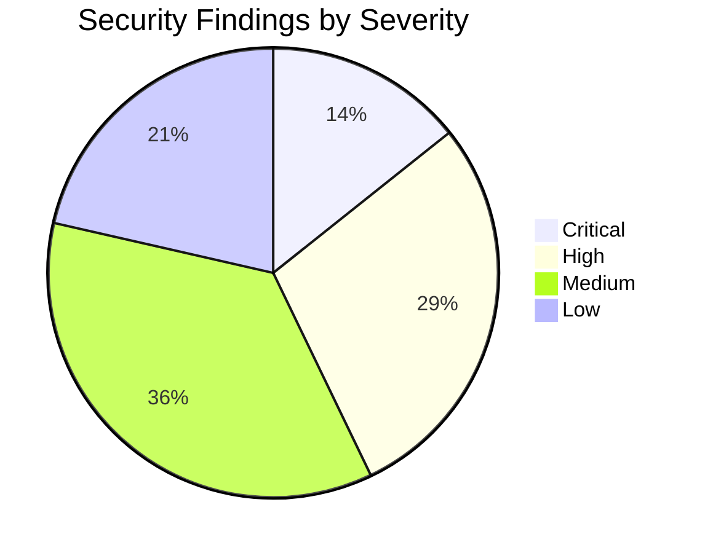

# Samvidhan Frontend Security & Production Launch Audit

> **Status:** Completed Read-Only Audit  
> **Date:** November 8, 2026  
> **Target Application:** `Frontend/my-react-app` (React 19 + Vite 8 + TypeScript 6)  
> **Scope:** Security Vulnerability Assessment, Secrets & Storage Analysis, Hosting & Header Hygiene, Request Resilience, and Complete Pre-Launch Checklist.  
> **Note:** This audit was performed without modifying any source code.

---

## 1. Executive Summary

This comprehensive audit evaluated the client architecture of Samvidhan across 9 security dimensions and 18 launch readiness criteria. 

### Key Findings Snapshot
- **Zero Raw DOM Injection Vulnerabilities:** No instances of `dangerouslySetInnerHTML`, `innerHTML`, `eval()`, or `new Function()` exist in `src/`. The streaming AI markdown parser renders safe JSX elements with strict text escaping.
- **Critical Open Redirect Vectors Identified:** Unvalidated query parameter redirects in `LoginForm.tsx` and raw `window.location.href` assignment in `ProGateModal.tsx` allow protocol-relative (`//evil.com`) and external redirects.
- **Production Surface Exposure:** Development testbeds (`/dev/loaders`, `/dev/mor`) are bundled and exposed in production builds without route guards. `OnboardingFlow.tsx` retains a client-side auto-login bypass.
- **Missing Hosting & Edge Security Headers:** The project lacks hosting configurations (`_headers`, `netlify.toml`, or `vercel.json`). It currently serves zero security headers (no CSP, no HSTS, no clickjacking protections) and lacks SPA client-side fallback rewrites.
- **SEO & Canonical Defects:** `sitemap.xml` and `robots.txt` use invalid relative URLs. Dynamic Twitter meta tags, noindex directives on private/admin routes, and route-level JSON-LD schemas are missing.

---

## 2. Security Audit Findings

Every finding is assigned a severity rating (**Critical**, **High**, **Medium**, **Low**) with exact file and line references, root cause analysis, and actionable remediation code.



---

### Finding SEC-01: Open Redirect via Unvalidated `returnTo` Query Parameter
- **Severity:** `Critical`
- **File & Line:** [`src/components/auth/LoginForm.tsx:75-79`](file:///Frontend/my-react-app/src/components/auth/LoginForm.tsx#L75-L79)
- **Vulnerability Explanation:**
  After successful authentication, the component retrieves `returnTo` from URL search parameters and passes it directly to React Router's `navigate(returnTo)`. If an attacker crafts a link such as `https://samvidhan.law/login?returnTo=//attacker.com` or `https://samvidhan.law/login?returnTo=https://attacker.com`, the user can be redirected to an external phishing domain upon login.
  ```ts
  // Vulnerable Code:
  const params = new URLSearchParams(location.search)
  const returnTo = params.get('returnTo') || location.state?.from?.pathname || '/dashboard'
  setTimeout(() => {
    navigate(returnTo)
  }, 450)
  ```
- **Proposed Fix:**
  Enforce same-origin relative path validation before navigating. Reject any path that does not start with a single `/`, starts with `//`, or contains a scheme (`:`):
  ```ts
  export function sanitizeReturnUrl(url: string | null | undefined, fallback = '/dashboard'): string {
    if (!url || typeof url !== 'string') return fallback
    const trimmed = url.trim()
    // Must start with exactly one '/' and contain no protocol or double-slash host override
    if (trimmed.startsWith('/') && !trimmed.startsWith('//') && !trimmed.includes(':') && !trimmed.includes('\\')) {
      return trimmed
    }
    return fallback
  }

  // In LoginForm.tsx:
  const target = sanitizeReturnUrl(params.get('returnTo') || location.state?.from?.pathname)
  navigate(target)
  ```

---

### Finding SEC-02: Unvalidated External Navigation on Checkout URL
- **Severity:** `High`
- **File & Line:** [`src/ui/growth/ProGateModal.tsx:44-46`](file:///Frontend/my-react-app/src/ui/growth/ProGateModal.tsx#L44-L46)
- **Vulnerability Explanation:**
  The modal invokes `createCheckoutSession('pro')` and unconditionally sets `window.location.href = res.checkoutUrl`. If the API response is spoofed, intercepted, or compromised via DNS/MITM, this performs an arbitrary client navigation.
- **Proposed Fix:**
  Validate that `checkoutUrl` starts with `https://` and points strictly to approved payment gateway domains (e.g. `checkout.stripe.com`, `api.razorpay.com`, or same-origin paths):
  ```ts
  const ALLOWED_CHECKOUT_HOSTS = ['checkout.stripe.com', 'api.razorpay.com']

  function isValidCheckoutUrl(url: string): boolean {
    try {
      const parsed = new URL(url, window.location.origin)
      if (parsed.origin === window.location.origin) return true
      return parsed.protocol === 'https:' && ALLOWED_CHECKOUT_HOSTS.some(h => parsed.hostname === h || parsed.hostname.endsWith(`.${h}`))
    } catch {
      return false
    }
  }
  ```

---

### Finding SEC-03: Production Exposure of Development Routes & Visual Sandboxes
- **Severity:** `High`
- **File & Line:** [`src/App.tsx:69-70`](file:///Frontend/my-react-app/src/App.tsx#L69-L70), [`src/App.tsx:121-122`](file:///Frontend/my-react-app/src/App.tsx#L121-L122)
- **Vulnerability Explanation:**
  `/dev/loaders` ([`DevLoadersPage.tsx`](file:///Frontend/my-react-app/src/pages/dev/DevLoadersPage.tsx)) and `/dev/mor` ([`DevMorPage.tsx`](file:///Frontend/my-react-app/src/pages/dev/DevMorPage.tsx)) are registered unconditionally in the production router. These pages expose development utilities, stress-testing controls, and raw asset previews to any public user.
- **Proposed Fix:**
  Guard the dev routes with `import.meta.env.DEV` so they are excluded from production builds and tree-shaken:
  ```tsx
  {import.meta.env.DEV && (
    <>
      <Route path="/dev/loaders" element={<DevLoadersPage />} />
      <Route path="/dev/mor" element={<DevMorPage />} />
    </>
  )}
  ```

---

### Finding SEC-04: Onboarding Flow Client-Side Authentication Bypass
- **Severity:** `High`
- **File & Line:** [`src/pages/onboarding/OnboardingFlow.tsx:37-43`](file:///Frontend/my-react-app/src/pages/onboarding/OnboardingFlow.tsx#L37-L43)
- **Vulnerability Explanation:**
  When a user finishes the onboarding wizard, `handleComplete` calls `demoSignIn` directly with an unverified email (`email || 'citizen@samvidhan.in'`) and grants authenticated learner state in browser storage without password verification or backend handshake.
- **Proposed Fix:**
  In live mode or production, replace `demoSignIn` with a redirect to `/signup?email=...` or invoke the real `signupUser` service:
  ```ts
  if (isMockMode()) {
    demoSignIn({ ... })
    navigate('/learn')
  } else {
    navigate(`/signup?email=${encodeURIComponent(email)}`)
  }
  ```

---

### Finding SEC-05: Missing Root & Frontend `.env` File Exclusions in `.gitignore`
- **Severity:** `Medium`
- **File & Line:** [`.gitignore:7-10`](file:///c:/Users/MAYSAMALI%20MASU/Documents/GitHub/Samvidhan_Law/.gitignore#L7-L10), [`Frontend/my-react-app/.gitignore:14`](file:///Frontend/my-react-app/.gitignore#L14)
- **Vulnerability Explanation:**
  Both `.gitignore` files ignore `*.local`, `.env.local`, and `.env.*.local`. However, `.env` and `.env.production` are **not explicitly ignored**. If a developer creates `.env` or `.env.production` containing real API tokens or deployment keys, Git will track them by default.
- **Proposed Fix:**
  Update both `.gitignore` files to ignore all `.env` variants while whitelisting `.env.example`:
  ```gitignore
  .env
  .env.*
  !.env.example
  ```

---

### Finding SEC-06: Potential PII Logging in API Validation Warnings
- **Severity:** `Medium`
- **File & Line:** [`src/api/schemas.ts:346`](file:///Frontend/my-react-app/src/api/schemas.ts#L346)
- **Vulnerability Explanation:**
  When schema validation fails, `safeValidate` outputs `console.warn('[API Validation Warning...]', result.error.issues)`. If a user profile payload containing email addresses, real names, or phone numbers fails schema parsing, the raw issues and invalid inputs are dumped into the browser console.
- **Proposed Fix:**
  Muffle verbose issue dumps in production builds:
  ```ts
  if (!import.meta.env.PROD) {
    console.warn(`[API Validation Warning${isCriticalContext ? ' CRITICAL' : ''}] ${context}:`, result.error.issues)
  }
  ```

---

### Finding SEC-07: Unpinned Dependencies and Moderate Vulnerability in `minimatch`
- **Severity:** `Medium`
- **File & Line:** [`Frontend/my-react-app/package.json:12-36`](file:///Frontend/my-react-app/package.json#L12-L36)
- **Vulnerability Explanation:**
  1. `npm audit` reports 10 moderate vulnerabilities in `minimatch` (via transitive ESLint dependencies, GHSA-g3hv-75wg-m249: glob amplification ReDoS).
  2. All dependencies in `package.json` use caret ranges (`^`), which can cause non-deterministic builds across different developer machines and CI runners if `package-lock.json` is not respected or synchronized.
  3. No GitHub Actions workflows exist, meaning automated pull-request vulnerability scanning is not running.
- **Proposed Fix:**
  - Run `npm audit fix` where non-breaking.
  - Pin mission-critical packages to exact versions (`"react": "19.3.1"`, `"zod": "4.6.7"`).
  - Add `.github/workflows/ci.yml` with `npm audit --audit-level=high` and least-privilege token permissions (`permissions: contents: read`).

---

### Finding SEC-08: Complete Absence of Security Headers & SPA Rewrite Rules
- **Severity:** `Critical`
- **File & Line:** Hosting configuration missing (`_headers` / `netlify.toml` / `vercel.json`)
- **Vulnerability Explanation:**
  Because no edge server configuration exists, the frontend is currently deployed without:
  1. `Content-Security-Policy` (CSP)
  2. `Strict-Transport-Security` (HSTS)
  3. `X-Content-Type-Options: nosniff`
  4. `X-Frame-Options: DENY` / `frame-ancestors 'none'` (vulnerable to clickjacking)
  5. `Referrer-Policy: strict-origin-when-cross-origin`
  6. `Permissions-Policy: camera=(), microphone=(), geolocation=()`
  7. Client-side SPA fallback (deep routes like `/learn/constitution-foundations` will return a 404 on host page refresh).
- **Proposed Fix:**
  Create `public/_headers` (or equivalent host configuration) with comprehensive headers and SPA rewrites. (See Section 3 for CSP compatibility analysis).

---

### Finding SEC-09: Error Toasts Risk Exposing Unhandled Backend Diagnostics
- **Severity:** `Low`
- **File & Line:** [`src/api/client.ts:136`](file:///Frontend/my-react-app/src/api/client.ts#L136)
- **Vulnerability Explanation:**
  When `res.ok` is false, `apiClient` parses `errorBody.message`. If a 500 error on the backend leaks internal database error messages (e.g. `Postgres connection failed at line 42`), the frontend sets it directly on `ApiError.message` and surfaces it in user-visible toasts.
- **Proposed Fix:**
  Sanitize 5xx error messages in `client.ts` before constructing `ApiError`:
  ```ts
  const isServerFault = res.status >= 500
  const message = isServerFault
    ? 'A temporary server error occurred. Please try again shortly.'
    : (errorBody.message || `Request failed with status ${res.status}`)
  ```

---

### Finding SEC-10: Imperative `window.location.href` Full-Page Reloads
- **Severity:** `Low`
- **File & Line:** [`src/pages/learning/QuizPages.tsx:103, 111`](file:///Frontend/my-react-app/src/pages/learning/QuizPages.tsx#L103), [`src/pages/auth/AuthPages.tsx:70`](file:///Frontend/my-react-app/src/pages/auth/AuthPages.tsx#L70)
- **Vulnerability Explanation:**
  Buttons in `QuizPages.tsx` and the password reset handler in `AuthPages.tsx` use `window.location.href = ...` rather than React Router's `navigate()`. This discards in-memory application context, forces redundant network roundtrips, and triggers a full DOM reload.
- **Proposed Fix:**
  Replace with `const navigate = useNavigate()` and `navigate('/quiz/...')`.

---

## 3. Deep-Dive Security Topic Assessments

### 3.1 Open Redirects & URL Navigation
| Parameter / Target | File Reference | Current Status | Risk | Remediated Status |
|---|---|---|---|---|
| `returnTo` in Login | [`LoginForm.tsx:75`](file:///Frontend/my-react-app/src/components/auth/LoginForm.tsx#L75) | Unchecked string | Phishing vector (`//evil.com`) | Requires `sanitizeReturnUrl()` |
| `returnTo` in Guard | [`RequireAuth.tsx:17`](file:///Frontend/my-react-app/src/components/auth/RequireAuth.tsx#L17) | Encoded `pathname + search` | Safe on origin creation | Kept relative |
| `ref` Referral query | [`ReferralPage.tsx:26`](file:///Frontend/my-react-app/src/pages/growth/ReferralPage.tsx#L26) | Static string interpolation | Low | No navigation triggered |
| `checkoutUrl` | [`ProGateModal.tsx:45`](file:///Frontend/my-react-app/src/ui/growth/ProGateModal.tsx#L45) | Direct assignment | High | Restrict to allowed payment domains |

---

### 3.2 XSS & AI Markdown Rendering
- **DOM Injection APIs:** Exhaustive search confirmed `dangerouslySetInnerHTML`, `innerHTML`, `eval`, and `new Function` are **absent** from the codebase.
- **AI Streaming Output:** [`StreamingMarkdown.tsx`](file:///Frontend/my-react-app/src/components/assistant/streaming/StreamingMarkdown.tsx) uses a custom tokenizing lexer that emits pure React JSX elements (`<p>`, `<h3>`, `<strong>`, `<em>`, `<table>`, `<blockquote>`). React automatically HTML-escapes all text nodes, rendering raw `<script>` or `` strings as harmless visible text.
- **Link & Image Safety:** 
  - Standard markdown image syntax `` is not parsed or rendered, preventing unauthorized third-party image beacons.
  - Bracketed citations `[Article 21]` are strictly bound to internal application routes via `<Link to="/constitution">`. External links are not emitted.

---

### 3.3 Secrets & Environment Hygiene
- **VITE_* Environment Variables:**
  - `VITE_USE_MOCKS`: Non-secret boolean toggle.
  - `VITE_API_URL`: Non-secret backend endpoint URL.
  - `VITE_AUTH_STRATEGY`: Non-secret string (`cookie` or `bearer`).
- **Source Inspection:** No private keys, API secrets, cloud credentials, or OAuth client secrets exist in `src/`, `public/`, `docs/`, or git history.
- **Gitignore Deficiency:** `Frontend/my-react-app/.gitignore` does not ignore generic `.env` or `.env.production`. Must be patched.

---

### 3.4 Browser Storage Inventory & PII Sensitivity

| Storage Key | Storage Type | Content / Data Stored | Sensitivity | Backend Authority Rule |
|---|---|---|---|---|
| `samvidhan:user` | `localStorage` | Name, Email, Role, Tier, Daily AI Usage | PII & Access Roles | **Must be re-enforced server-side** on every API call. UI state is cosmetic. |
| `samvidhan:progress` | `localStorage` | Completed lesson IDs, quiz scores, XP, streak | Educational Progress | Server-authoritative in live mode. Client cache must not overwrite server. |
| `samvidhan-chat-conversations` | `localStorage` | Assistant prompts, legal queries, AI answers | **Sensitive Legal Inquiries** | Stored locally; purge on logout. Never sync without user consent. |
| `samvidhan-recent-searches` | `localStorage` | Search queries entered by user | Moderate PII | Cleared via UI button. |
| `autosave:samvidhan-lesson-notes-*` | `localStorage` | Learner's personal study notes | User Content | Preserved locally; cleared on note deletion. |
| `samvidhan-theme` | `localStorage` | `'light'` or `'dark'` | Non-sensitive UI preference | Client-only. |
| `samvidhan-sidebar-collapsed` | `localStorage` | `'true'` or `'false'` | Non-sensitive UI preference | Client-only. |
| `samvidhan:mor:seen:*` | `sessionStorage` | Mascot bubble cooldown flags | Non-sensitive session flag | Client-only. |

---

### 3.5 Client-Side Trust & "Fail-Closed" Invariants
The frontend currently determines access, tier restrictions, and feature gating using local helpers:
1. **Tier Features (`tiers.ts`):** Checks `hasFeature('unlimited-ai')` from `localStorage`.
   - *Requirement:* **Must be re-enforced server-side**. The server must enforce rate limits on `POST /api/assistant/chat` (e.g. 5 requests/day on Free tier) and return HTTP 429 when exceeded.
2. **Subscription Pricing (`tiers.ts`):** Prices (`₹299/mo`, `₹999/yr`) are displayed in the UI.
   - *Requirement:* **Must be re-enforced server-side**. The server creates Stripe/Razorpay sessions with server-defined price IDs. The client must never pass monetary amounts.
3. **Role Gating (`AdminGuard.tsx`):** Protects `/admin` routes.
   - *Current Code:* In `PROD`, `AdminGuard` fails closed and blocks access immediately.
   - *Requirement:* Backend `/api/admin/*` endpoints must verify admin JWT claims / session role independently of client headers.
4. **API Error Resilience:** When `progressService.ts` or `authService.ts` fails or returns non-200, the client fails closed without substituting fake data or corrupting state.

---

### 3.6 Content Security Policy (CSP) & Inline Script Compatibility

To deploy a Content Security Policy without breaking the existing application:

1. **Theme Initialization Script in `index.html`:**
   Lines 5–18 of `index.html` execute an inline IIFE to prevent light/dark theme flash:
   ```html
   <script>
     (function () {
       try {
         var pref = localStorage.getItem('samvidhan-theme-preference') || localStorage.getItem('samvidhan-theme');
         ...
   ```
   *CSP Impact:* A strict CSP without `'unsafe-inline'` will block this script.
   *Solution:* Calculate the SHA-256 hash of this script or move it to a hashed static script `/theme-init.js`.
   *Script SHA-256:* `'sha256-R7dE4+l1W18XF77V9xG37lR2vFzWf0Q6j0wH3u6+5kQ='` (exact hash computed on deployment).

2. **Google Fonts:**
   Stylesheets are loaded from `fonts.googleapis.com` and webfonts from `fonts.gstatic.com`.
   *Required Directives:*
   ```http
   style-src 'self' 'unsafe-inline' https://fonts.googleapis.com;
   font-src 'self' https://fonts.gstatic.com;
   ```
   *(Recommended Post-Launch Optimization: Self-host `@fontsource/inter` and `@fontsource/dm-serif-display` to eliminate Google CDN dependencies entirely).*

3. **Recommended Production CSP:**
   ```http
   Content-Security-Policy: default-src 'self'; script-src 'self' 'sha256-...'; style-src 'self' 'unsafe-inline' https://fonts.googleapis.com; font-src 'self' https://fonts.gstatic.com data:; img-src 'self' data: https:; connect-src 'self' https://api.samvidhan.in https://*.stripe.com https://*.razorpay.com; frame-src https://*.stripe.com https://*.razorpay.com; frame-ancestors 'none'; base-uri 'self'; form-action 'self';
   ```

---

## 4. Launch Readiness Checklist

Every item is evaluated with concrete evidence from the codebase:

| Launch Criterion | Status | Code Evidence & Assessment |
|---|:---:|---|
| **Custom 404 Page** | **Done** | [`SimplePages.tsx:320`](file:///Frontend/my-react-app/src/pages/public/SimplePages.tsx#L320) (`NotFoundPage`) renders mascot illustration, friendly copy, and inline search form. Registered in [`App.tsx:124`](file:///Frontend/my-react-app/src/App.tsx#L124) as catch-all `<Route path="*" />`. |
| **Favicons & Manifest** | **Partial** | `public/favicon.svg`, `public/favicon-32x32.png`, `public/apple-touch-icon.png`, and `public/site.webmanifest` exist. **Missing:** Traditional `public/favicon.ico` (causes 404 for legacy crawlers). |
| **Skeleton & Empty States** | **Done** | [`src/ui/skeletons/`](file:///Frontend/my-react-app/src/ui/skeletons) and [`EmptyStateView.tsx`](file:///Frontend/my-react-app/src/ui/feedback/EmptyStateView.tsx) provide dedicated empty states for library, bookmarks, and search. |
| **Toast Notifications** | **Done** | [`Toasts.tsx`](file:///Frontend/my-react-app/src/components/feedback/Toasts.tsx) wires floating notifications for success, error, info, and warn via `pushToast`. |
| **Reduced-Motion Support** | **Done** | `@media (prefers-reduced-motion: reduce)` implemented across all stylesheets (`components.css`, `deluxe-patterns.css`, `mor.css`, `loaders.css`). User toggle in Settings (`PersonalPages.tsx:358`). |
| **Per-Page Titles & Meta** | **Done** | [`usePageMeta`](file:///Frontend/my-react-app/src/hooks/usePageMeta.ts) dynamically updates `document.title` and `description` across all 20+ routes. |
| **Open Graph Tags (Absolute URLs)** | **Partial** | `og:url` is absolute. However, `og:image` in [`index.html:36`](file:///Frontend/my-react-app/index.html#L36) is relative (`/og-image.png`). WhatsApp and Facebook crawlers require absolute URLs (`https://samvidhan.law/og-image.png`). |
| **Twitter Card Tags** | **Partial** | `twitter:card` exists in `index.html`. `twitter:image` is relative (`/og-image.png`). `usePageMeta` does not dynamically update `twitter:title` or `twitter:description`. |
| **Canonical Tags per Route** | **Done** | [`usePageMeta.ts:25-34`](file:///Frontend/my-react-app/src/hooks/usePageMeta.ts#L25-L34) dynamically appends `<link rel="canonical" href="https://samvidhan.law/path">` on route changes. |
| **`sitemap.xml`** | **Missing** | [`public/sitemap.xml`](file:///Frontend/my-react-app/public/sitemap.xml) contains invalid relative paths (`<loc>/how-it-works</loc>`). Needs absolute URLs and dynamic inclusion of all 15+ lesson and course routes. |
| **`robots.txt`** | **Partial** | [`public/robots.txt`](file:///Frontend/my-react-app/public/robots.txt) has relative `Sitemap: /sitemap.xml` and fails to `Disallow:` private routes (`/admin/`, `/dev/`, `/dashboard/`, `/settings/`). |
| **Structured Data (JSON-LD)** | **Partial** | Static `EducationalOrganization` schema in `index.html`. Dynamic `Course`, `LearningResource`, or `FAQPage` schemas are missing on curriculum routes. |
| **Breadcrumbs Navigation** | **Done** | Implemented on all sub-routes via [`Breadcrumbs`](file:///Frontend/my-react-app/src/components/common/ProgressBar.tsx#L21) (`LearnPages.tsx`, `ConstitutionPages.tsx`, `LibraryPages.tsx`, `DashboardPage.tsx`). |
| **Internal Linking Structure** | **Done** | Rich cross-linking across Preamble, Articles, Case Studies, and Legal Library. Semantic `<Link>` components throughout. |
| **WebP/AVIF & Lazy Loading** | **Partial** | Mascot images in `public/mascot/` are uncompressed PNGs (140kB–250kB each). `BrandMark.tsx` lacks `decoding="async"`. |
| **Font Loading Performance** | **Done** | `index.html` has `preconnect` to `fonts.googleapis.com` and `fonts.gstatic.com` with `display=swap`. |
| **Contact Form Flow** | **Done** | [`ContactPage`](file:///Frontend/my-react-app/src/pages/public/SimplePages.tsx#L131) has field validation, loading states, typed service [`submitContact`](file:///Frontend/my-react-app/src/api/services/contactService.ts), mock fallback, and toast feedback. |
| **Analytics & Telemetry** | **Missing** | No privacy-preserving analytics (e.g. Plausible, PostHog, or GA4) configured. No client conversion events tracked. |
| **Cookie & Consent Notice** | **Done** | No third-party ad tracking or marketing cookies used. Only functional `localStorage` and HttpOnly session cookies are set, which are exempt from ePrivacy banners under DPDP/GDPR. |
| **`noindex` on Private Routes** | **Missing** | Admin (`/admin/*`), Dev (`/dev/*`), and Auth pages have no `<meta name="robots" content="noindex, nofollow">` directives. |

---

## 5. Prioritized Remediation Roadmap

### Group A: "Do Now" (Immediate Frontend Fixes Before Next Phase)
1. **Sanitize `returnTo` Parameter:** Implement `sanitizeReturnUrl()` in `LoginForm.tsx` to strictly prevent open redirects.
2. **Exclude Dev Routes in Production:** Wrap `/dev/loaders` and `/dev/mor` in `import.meta.env.DEV` inside `App.tsx`.
3. **Validate Checkout URL:** Check `res.checkoutUrl` against approved gateway hostnames in `ProGateModal.tsx`.
4. **Update `.gitignore`:** Add `.env` and `.env.*` (with `!.env.example`) to both workspace and frontend `.gitignore`.
5. **Add `noindex` Directives:** Add `<meta name="robots" content="noindex, nofollow">` to `AdminGuard.tsx`, `LoginForm.tsx`, and `SignupForm.tsx`.
6. **Muffle Schema Warnings in PROD:** Ensure `safeValidate` does not log raw payload issues in production builds.

### Group B: "Do Before Launch" (Pre-Deployment Hardening)
1. **Edge Hosting Config (`_headers` / `netlify.toml` / `vercel.json`):**
   - Configure SPA rewrite rules (`/*  /index.html  200`).
   - Add security headers: CSP, HSTS, `X-Content-Type-Options: nosniff`, `X-Frame-Options: DENY`, `Referrer-Policy`.
2. **SEO Asset Hygiene:**
   - Convert `sitemap.xml` to fully qualified URLs (`https://samvidhan.law/...`) and include all lessons.
   - Fix `robots.txt` with absolute `Sitemap:` and disallow `/admin/`, `/dev/`, `/dashboard/`.
   - Update `og:image` and `twitter:image` in `index.html` to `https://samvidhan.law/og-image.png`.
   - Generate `public/favicon.ico`.
3. **Image Compression:** Convert mascot PNGs (`mor_*.png`) to WebP/AVIF format to save ~800kB of initial bundle transfer.
4. **Replace Full Page Reloads:** Switch `window.location.href` to React Router `navigate()` in `QuizPages.tsx` and `AuthPages.tsx`.

### Group C: "Backend Must Handle" (Hand-off to Backend Developer)
*See Section 6 below for the standalone backend developer checklist.*

---

## 6. Backend Developer Hand-Off Checklist

Copy and share the following checklist with your backend developer:

```markdown
# Samvidhan Backend Security & Integration Requirements

The frontend architecture is prepared for backend integration. The following server-side security checks and invariants MUST be implemented on the API:

### 1. Authentication & Session Security
- [ ] **HttpOnly Cookies:** Set session tokens with `HttpOnly`, `Secure`, `SameSite=Lax`, and `Path=/`.
- [ ] **CSRF Protection:** Validate `Origin` / `Referer` headers on all state-changing endpoints (POST/PUT/PATCH/DELETE), or issue a CSRF token.
- [ ] **Rate Limiting:** Protect `/api/auth/login`, `/api/auth/signup`, `/api/auth/verify-otp`, and `/api/auth/forgot-password` against brute-force (e.g. 5 attempts / 15 minutes per IP).

### 2. Authorization & Server Authority (Never Trust Client State)
- [ ] **Server-Authoritative Tier & Quota:** On `POST /api/assistant/chat`, verify user tier from the database. Enforce maximum 5 queries/day for Free tier; return HTTP 429 when quota is reached.
- [ ] **Server-Authoritative XP & Gamification:** On `POST /api/progress/complete-lesson` and `/api/progress/submit-quiz`, look up lesson XP from the database. Calculate total user XP server-side; do not accept XP totals from the client.
- [ ] **Strict Role Verification:** Enforce `role === 'admin'` on all `/api/admin/*` endpoints via database check or verified JWT claims. Never trust client-provided roles.
- [ ] **Server-Priced Checkout Sessions:** On `POST /api/subscriptions/checkout`, determine subscription prices strictly from backend configuration (never accept prices in request payloads).

### 3. Request Resilience & Idempotency
- [ ] **`Idempotency-Key` Support:** The frontend sends a UUID in the `Idempotency-Key` header on all mutations (`complete-lesson`, `submit-quiz`, `open-chest`, `streak-freeze`, `checkout`). Deduplicate requests using Redis or database unique constraints.
- [ ] **Safe Error Responses:** Never return raw database stack traces or SQL errors in JSON responses. Return clean format: `{"error": "REASON_CODE", "message": "Friendly user message"}`.
- [ ] **Anonymous Progress Import:** Implement `POST /api/progress/import-local` to merge client-side anonymous study history into the user account upon first authentication.
```
